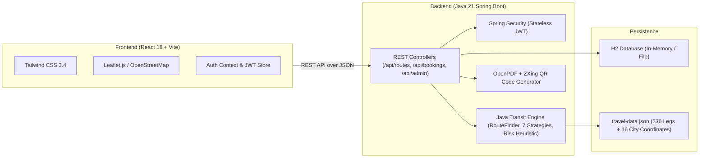

<div align="center">

# 🧭 JOURNEY

### Enterprise Multi-Modal Transit Engine & Travel Planner

[](https://openjdk.org/)
[](https://spring.io/projects/spring-boot)
[](https://react.dev)
[](https://www.typescriptlang.org/)
[](https://tailwindcss.com/)
[](https://leafletjs.com/)

</div>

---

## ✨ Overview

**JOURNEY** is a full-stack, enterprise-grade multi-modal transit planner and booking platform. It computes connected travel itineraries across **16 major Indian cities** combining flights, trains, and intercity buses.

Unlike simple CRUD apps, JOURNEY is powered by a high-performance **Java 21 graph traversal routing engine** with multi-criteria Pareto ranking, connection risk heuristics, carbon footprint calculations, and real-time disruption modeling.

---

## 🌟 Key Features

### 🎓 For Travelers

| Feature | Description |
|---|---|
| 🔍 **Multi-Modal Route Discovery** | Depth-first search (DFS) over a transit network of 236 legs across 16 cities with up to 4 transfers |
| ⚖️ **7 Ranking Strategies** | Sort itineraries by Cheapest, Fastest, Fewest Transfers, Best Value, Least Waiting, Lowest Risk, or **🌱 Greenest (lowest CO₂)** |
| 🗺️ **Interactive OpenStreetMap** | Visualizes route paths in real-time with color-coded modes (🟠 Bus, 🔵 Train, 🟣 Flight) and city coordinates |
| 📊 **Gantt Journey Timeline** | Visual breakdown of travel time vs station layover waiting times |
| 🛡️ **Connection Risk Scoring** | Evaluates transfer safety: High risk (< 60m layover), Medium (< 120m), or Low risk |
| 🌿 **Carbon Footprint Tracking** | Automatic per-passenger CO₂ emission estimates based on vehicle type and travel distance |
| 🔀 **Side-by-Side Comparison** | Compare up to 4 routes simultaneously to evaluate cost vs time trade-offs |
| 🎫 **E-Ticket PDF Generation** | One-click booking with instant PDF boarding pass download featuring an **embedded QR code** |
| 🔐 **Secure JWT Authentication** | Role-based authentication (Traveler vs Admin) |

### 🛠️ For Transit Admins

| Feature | Description |
|---|---|
| 📡 **Live Operations Dashboard** | Real-time system telemetry: total bookings, registered travelers, revenue, and active disruptions |
| ⚠️ **What-If Disruption Engine** | Cancel flights/trains or inject real-time delays (+30m, +60m, +90m) — the routing engine instantly recalculates paths |
| 📋 **Passenger Manifest** | Comprehensive log of all tickets booked across the network |
| 🔄 **One-Click Restoration** | Instantly restore all services to normal operating schedule |

---

## 🖥️ Demo Credentials

The application auto-seeds demo accounts upon launch:

| Role | Email | Password | Permissions |
|---|---|---|---|
| 👨‍💼 **Admin Officer** | `admin@journey.com` | `admin123` | Full access to Operations Hub, Disruption Simulation, Booking Logs |
| 🎓 **Traveler Demo** | `traveler@journey.com` | `traveler123` | Route search, multi-modal booking, PDF ticket download |
| 🎓 **Student Demo** | `student@journey.com` | `student123` | Alternate traveler account |

---

## 🏗️ Architecture & Tech Stack



### Technology Breakdown

- **Backend:** Java 21, Spring Boot 3.3.4, Spring Security 6, Spring Data JPA, H2 Database (PostgreSQL compatible)
- **PDF & QR Code:** OpenPDF 2.0.3, ZXing 3.5.3
- **Frontend:** React 18, TypeScript 5, Vite 5, Tailwind CSS 3.4, Lucide Icons, Leaflet 1.9
- **Build Tools:** Apache Maven 3.10, Node.js v20+ / v26

---

## 🏛️ OOP & Software Engineering Concepts

| Concept | Implementation in Code |
|---|---|
| **Abstraction** | Abstract `Leg`, `TransportProvider` interface, `RankingStrategy` interface |
| **Encapsulation** | Immutable `Route` models, private validated fields |
| **Inheritance & Polymorphism** | `BusLeg`, `TrainLeg`, `FlightLeg` overriding buffer times, CO₂ rates, and travel tips |
| **Factory Pattern** | `LegFactory` dynamically instantiating typed transport hops |
| **Builder Pattern** | `SearchRequest.Builder` constructing complex search criteria |
| **Strategy Pattern** | 7 interchangeable ranking strategies (`CheapestStrategy`, `GreenestStrategy`, etc.) |
| **Observer Pattern** | `DisruptionRegistry` notifying routing services upon network disruptions |
| **Facade Pattern** | `TravelRouteService` abstracting complex graph traversal from REST controllers |
| **Dependency Inversion (SOLID)** | Core engine depends on `TransportProvider` abstractions, not concrete files |

---

## 🚀 Quick Start

### Prerequisites
- **JDK 21** or later
- **Apache Maven 3.8+**
- **Node.js 18+** and **npm**

### One-Command Startup (Recommended)

**Linux / macOS:**
```bash
./start.sh
```

**Windows:**
```bat
start.bat
```

The script boots the Spring Boot backend on **http://localhost:8080** and the React frontend on **http://localhost:5173**.

### Manual Startup

**1. Start the Java Backend:**
```bash
cd backend
mvn spring-boot:run
```

**2. Start the React Frontend:**
```bash
cd frontend
npm install
npm run dev
```

Visit **http://localhost:5173** in your browser.

---

## 📡 REST API Reference

| Method | Endpoint | Access | Description |
|---|---|---|---|
| `POST` | `/api/auth/login` | Public | Authenticate user & receive JWT token |
| `POST` | `/api/auth/register` | Public | Register a new traveler account |
| `GET` | `/api/auth/me` | User | Get current logged-in user profile |
| `GET` | `/api/routes/cities` | Public | List all 16 supported transit cities |
| `GET` | `/api/routes/coordinates` | Public | Get geographic coordinates for Leaflet map |
| `POST` | `/api/routes/search` | Public | Find and rank feasible multi-modal routes |
| `POST` | `/api/bookings` | User | Reserve itinerary and create booking |
| `GET` | `/api/bookings` | User | View current user's booking history |
| `POST` | `/api/bookings/{id}/cancel` | User | Cancel an existing booking |
| `GET` | `/api/bookings/{id}/ticket` | Public | Download official PDF E-Ticket with QR code |
| `GET` | `/api/admin/stats` | Admin | System telemetry and revenue metrics |
| `GET` | `/api/admin/legs` | Admin | Inspect all 236 transit legs in the network |
| `POST` | `/api/admin/disruptions` | Admin | Inject cancellations or delays (+30m, +60m) |
| `GET` | `/api/admin/bookings` | Admin | Master log of all passenger bookings |
