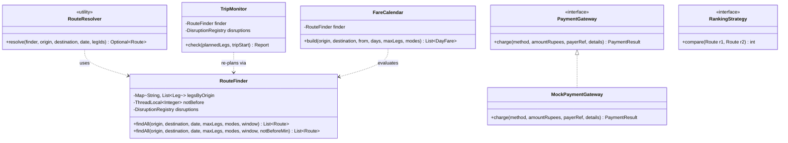

# JOURNEY — Object-Oriented Architecture & Interface Specifications

This document outlines the software engineering and Object-Oriented Design (OOD) architecture of the **JOURNEY** transit planner, detailing class hierarchies, design patterns, and interfaces for academic evaluation.

---

## 1. Design Patterns Implemented

| Pattern | Interface / Base | Concrete Implementations | Role & Architectural Purpose |
|---|---|---|---|
| **Strategy Pattern** | `RankingStrategy` | `CheapestStrategy`, `FastestStrategy`, `BalancedStrategy`, `FewestTransfersStrategy`, `WaitingTimeStrategy`, `LowestRiskStrategy`, `GreenestStrategy` | Encapsulates comparator logic for sorting graph routes based on multi-objective metrics without altering DFS traversal. |
| **Strategy / Adapter** | `PaymentGateway` | `MockPaymentGateway` | Standardizes payment transactions (UPI, Cards, Net Banking) and demo decline rules under a unified interface. |
| **Factory Pattern** | `LegFactory` | `BusLeg`, `TrainLeg`, `FlightLeg` | Decouples JSON/database parsing from polymorphic transit representation. |
| **Observer Pattern** | `DisruptionRegistry` | `DisruptionRegistry` (ConcurrentHashMap event bus) | Thread-safe observer tracking live delays, cancellations, and notifying the routing engine and listeners. |
| **Dynamic Policy** | `FarePolicy` | `FarePolicy` | Applies time-based and mode-specific dynamic pricing (weekend surcharges, peak flights, last-minute booking). |
| **Policy Pattern** | `RefundPolicy` | `RefundPolicy` | Encapsulates transparent refund tiers (90% for >=48h, 75% for 24-48h, 50% for 6-24h, 0% for <6h). |

---

## 2. Core Class & Interface Diagram (Mermaid)

---

## 3. Server-Side Trust & Anti-Tamper Security

In accordance with enterprise security principles, client-side fare data and timings are treated as untrusted:
1. **Route Resolution (`RouteResolver`)**: When a user books an itinerary, the browser sends only `legIds`. The server re-executes graph validation to ensure all legs connect, run on that specific calendar day, and are not disrupted.
2. **Server-Side Pricing (`FarePolicy`)**: The total fare is computed on the server by summing validated leg fares and pax multiplier.
3. **Disruption Concurrency (`DisruptionRegistry`)**: All cancellation and delay updates utilize `ConcurrentHashMap` and atomic operations to eliminate lost updates under high concurrency.
